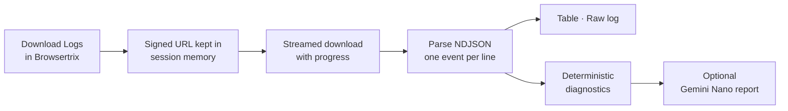

<div align="center">

# Browsertrix Crawl Log Viewer

**Read a Browsertrix crawl log as answers, not as thousands of JSON lines.**

[](#-requirements)
[](#)
[](#gemini-nano-optional)
[](#connect-your-browsertrix)
[](#-development)

by **Thomas Smedebøl**, Royal Danish Library

[Requirements](#-requirements) · [Install](#-install-in-developer-mode) · [Usage](#-usage) · [How it works](#-how-it-works) · [Safety](#-safety-and-privacy) · [Development](#-development)

</div>

---

## ✨ What it does

A Browsertrix crawl log is newline-delimited JSON: one event per line, often hundreds of thousands of them. The answers a curator or crawl engineer needs are spread across those lines. **Browsertrix Crawl Log Viewer** catches **Download Logs** in Browsertrix and opens the log in a viewer built for crawl QA:

| | |
|---|---|
| 📊 **Table** | every event, sortable and filterable, with status, type, MIME group, size, domain, page and where each URL came from; columns can be dragged into any order |
| 📜 **Raw log** | the original log as code, with line numbers, syntax colouring and plain-text or regular-expression search |
| 🩺 **Diagnostics** | crawl outcome, limits, blocking and throttling signals, memory, storage problems, timeouts and soft-404 suspects |
| 🤖 **Gemini Nano** | an optional short report from Chrome's on-device model, built from the diagnostics, not from the raw log |

> [!NOTE]
> The table and the raw log stay the source of truth. Every derived finding says whether it is a logged fact, a heuristic or an inference, and inferred relationships are never shown as exact.

---

## 📋 Requirements

> [!IMPORTANT]
> Browsertrix Crawl Log Viewer runs in **desktop Google Chrome** and works with **any Browsertrix**: Webrecorder's hosted service or your own installation. After installing, you connect it to your Browsertrix once (step 5 below). No Browsertrix address is built in.

| Browser | Supported |
|---|:---:|
| Google Chrome on Windows, macOS or Linux | ✅ |
| Chrome on Android or iOS | ❌ *no extension support* |
| Other Chromium browsers (Edge, Brave, Opera, Vivaldi …) | ❌ *not supported, not tested* |

### Gemini Nano (optional)

The viewer can ask Chrome's on-device model for a **short report**. It runs only when you press the button, and every other feature works without it. It needs **Chrome 138 or later**, where the Prompt API is available to extensions, and the computer must meet [Chrome's requirements for built-in AI](https://developer.chrome.com/docs/ai/get-started):

| | Requirement |
|---|---|
| 💻 Operating system | Windows 10/11, macOS 13 (Ventura)+, Linux, or ChromeOS on Chromebook Plus |
| 💾 Storage | at least **22 GB free** on the volume holding the Chrome profile |
| ⚙️ Hardware | GPU with **more than 4 GB VRAM**, *or* **16 GB RAM** and **4+ CPU cores** |
| 📶 Network | unmetered connection for the one-time model download |

After the download the model runs locally, and no data leaves the computer.

> [!TIP]
> If Gemini Nano can't run, the button reads **Why is Gemini Nano unavailable?** Clicking it explains the reason for *your* browser and what to do: use Google Chrome instead of another browser, update an old Chrome, turn built-in AI back on (or ask your IT department if a policy switched it off), or check the computer requirements above.

---

## 🚀 Install in developer mode

The extension is not in the Chrome Web Store; it is loaded as an **unpacked** extension.

1. [Download](https://github.com/thsm-kb/Browserextensions/raw/refs/heads/main/Browsertrix%20Crawl%20Log%20Viewer/Browsertrix%20Crawl%20Log%20Viewer%20v1.12.0.zip) and unzip the extension to a folder of your choice.
2. **Open** `chrome://extensions` in the address bar.
3. **Turn on Developer mode** with the switch in the top-right corner.
4. Click **Load unpacked** and select the folder that contains `manifest.json` (the folder is called **Browsertrix Crawl Log Viewer**).
5. **Connect your Browsertrix (required).** The **Settings** page opens by itself; see [Connect your Browsertrix](#connect-your-browsertrix) below.
6. **Pin it.** Click the 🧩 puzzle-piece icon in the toolbar and pin **Browsertrix Crawl Log Viewer**.
7. *(Optional)* In the viewer, press **Analyze with Gemini Nano**. If the model isn't downloaded yet, the button reads **Download model & analyze** and the viewer shows the download progress.

> [!WARNING]
> Step 5 is required. Without a connected address the extension doesn't react to **Download Logs** anywhere (you can still open log files with **Open local log**).

### Connect your Browsertrix

1. **Copy the address.** Open your Browsertrix in a tab and copy the address from the address bar. Any page inside Browsertrix will do; only the first part, such as `https://browsertrix.example.org`, is used.
2. **Paste it** into the field on the **Settings** page and click **Add**.
3. **Click Allow.** Chrome asks whether the extension may *"Read and change your data on"* that site. This lets it notice the **Download Logs** button and download the log for you. It gets access to that one site only.
4. **Check the result.** Settings tests the address and shows **Browsertrix confirmed**. If it says the address *did not answer like Browsertrix*, check for a typo.
5. **Try it.** Open a crawl in Browsertrix and click **Download Logs**. The viewer opens. Browsertrix tabs that were already open work without reloading.

> [!TIP]
> Open **Settings** again at any time with the **Settings** button in the viewer, or via `chrome://extensions` → **Details** → **Extension options**. You can add several addresses (for example a test and a production Browsertrix) and remove them again. The addresses are stored only in your Chrome profile.

<details>
<summary><b>Updating to a new version</b></summary>

Replace the folder's contents with the new version and click the **↻ reload** arrow on the extension's card in `chrome://extensions`. Your Browsertrix addresses, column order and raw-log search options are kept.

</details>

<details>
<summary><b>Updating from version 1.8 or older</b></summary>

From version 1.9 the extension has no built-in Browsertrix address. After updating, the **Settings** page opens: add the address of your Browsertrix once, as described in [Connect your Browsertrix](#connect-your-browsertrix).

</details>

<details>
<summary><b>Updating from version 1.7 or older</b></summary>

Older versions were unzipped to a folder called `browsertrix-log-viewer`. Chrome identifies an unpacked extension by its folder, so loading the new **Browsertrix Crawl Log Viewer** folder *next to* the old one installs a second copy, and both would open a viewer when you click **Download Logs**. Do one of the following:

- **Remove** the old card in `chrome://extensions`, then load the new folder (your column order is reset once), or
- **copy** the contents of the new folder into your existing `browsertrix-log-viewer` folder and click **↻ reload** (everything is kept).

</details>

<details>
<summary><b>Managed (company / institution) computers</b></summary>

If your organisation's Chrome policies block developer mode or unpacked extensions, the extension can't be installed. Ask your IT department.

</details>

---

## 🧭 Usage

1. Open a finished crawl in your Browsertrix and click **Download Logs**.
2. Instead of a file download, the viewer opens in a new tab and shows the download progress.
3. Read the diagnostics at the top, then use the **Table** and **Raw log** tabs to dig in.

To open a log you already have, click the **Browsertrix Crawl Log Viewer** icon and choose **Open local log**. Browsertrix NDJSON logs (`.log`, `.ndjson`, `.txt`, `.json`) are accepted.

> [!TIP]
> The **Guide** button in the viewer explains every column, filter and finding, with the caveats that matter when interpreting them.

### What you get

**The table.** One row per log event. Sort by any column; drag a column header left or right to move it (Alt+←/→ with the keyboard). Columns can only be moved, never hidden. Filter by text, level, context, file type and MIME group, and the totals follow the filter: unique pages, unique resources, combined, average, median and largest size. The **fields** button at the end of each message shows the event's full `details` JSON and a link to the line in the raw log.

**The raw log.** The log exactly as Browsertrix wrote it, as code. Line numbers match the table's source line. Gutter marks show warnings, errors and lines that aren't valid JSON.

| Raw-log control | What it does |
|---|---|
| 🔎 Search | plain text by default; **.\*** for a regular expression, **Aa** to match case; Enter and Shift+Enter move between matches |
| ≡ Only matching lines | shows only lines with a match, like `grep` |
| ↩ Wrap lines | wraps long lines instead of scrolling sideways |
| # Go to line | jumps to a line number |

**The diagnostics**, calculated by the viewer itself:

| Finding | Based on |
|---|---|
| 🏁 Crawl outcome | pages completed, failed, skipped or not confirmed complete |
| 🛑 Limits | Browsertrix's own stop messages: size, time, failed-page and disk-utilization thresholds, page limit |
| 🚧 Blocking / throttling | 401/403/407/429/503 statuses, WAF and challenge messages, rate-limit messages |
| 🧠 Memory | RSS and heap of the crawler process, when the crawl was logged at debug level |
| 💾 Storage | write, quota and WARC-upload errors and disk-utilization stops |
| 👻 Soft 404 | whether the first seed's host answers 200 for a page that doesn't exist, and which resources look like that answer |
| 🧭 Provenance | where each page or resource URL was discovered, labelled EXACT, INFERRED, INITIAL or UNKNOWN |

---

## 🔬 How it works



1. **Interception.** On each Browsertrix address you connected in Settings, a content script catches the **Download Logs** click. The service worker checks that the link comes from that same connected address and is a real Browsertrix log endpoint, then keeps the signed link in Chrome's session memory under a random key; only that key goes into the viewer's address.
2. **Download.** The viewer streams the log and shows percentage and bytes, or received bytes when the size is unknown. Lines are parsed while they arrive, in short slices with visible progress, so the page never freezes, even for logs of several hundred MB.
3. **Parsing.** Each line is one event. Status, size, domain, page, file type and MIME group are taken from what Browsertrix logged; a file type is inferred from a URL only for recognized extensions, never from a hostname such as `.dk`.
4. **Diagnostics.** Findings are matched against Browsertrix Crawler's actual messages and stay conservative: a Cloudflare *check* is not a block, and a page giving up after retries is not a crawl limit.
5. **Gemini Nano.** The model receives only the compact fact summary from step 4, never the raw log, and writes a short prioritised report. *JavaScript calculates; Gemini interprets.*

<details>
<summary><b>MIME groups</b></summary>

MIME names and top-level types follow the [IANA Media Types registry](https://www.iana.org/assignments/media-types/media-types.xhtml). IANA does not define QA groupings such as *Office / documents*, so the viewer adds a documented functional layer on top.

| Group | Examples |
|---|---|
| Web pages | HTML/XHTML |
| Images | JPEG, PNG, GIF, WebP, SVG, AVIF … |
| Office / documents | PDF, Word, Excel, PowerPoint, OpenDocument, RTF … |
| Audio files / Video files | ordinary MP3, OGG, WAV, FLAC / MP4, WebM, MOV |
| Streaming manifests / playlists | HLS, DASH |
| Streaming audio / video / media segments | media with a streaming-specific signal, TS/M4S segments |
| Archives / compressed | ZIP, TAR, GZIP, 7z, RAR … |
| Structured data | JSON, XML … |
| Scripts / web code · Stylesheets · Fonts | JavaScript, TypeScript · CSS · WOFF/WOFF2/TTF/OTF |
| E-books · 3D / models · Messages / multipart | EPUB · model/\* · message/\*, multipart/\* |
| Text · Application / other · Binary / unknown | other text/\* · unassigned application/\* · generic binary |

Streaming is conservative: an ordinary MP3 or MP4 is an audio or video file, not streaming, unless a streaming manifest, segment MIME type or segment URL says otherwise.

</details>

<details>
<summary><b>Soft-404 test</b></summary>

The viewer requests `<first-seed origin>/browsertrixsoft404detect`, a path that should not exist. If it answers **200**, the host may serve soft 404s. Resources on the same host with the same type and about the same size (±8 % or ±2 KB, whichever is larger) are marked **SOFT404?**. They are suspects for review, not confirmed missing pages. Chrome asks for permission to that one host before the test runs.

</details>

---

## 🔒 Safety and privacy

- **The download token never leaves the extension.** Browsertrix puts an `auth_bearer` login token in the log link. The extension passes the link from the Browsertrix page to the viewer through Chrome's in-memory session storage, which only the extension's own pages can read. The viewer deletes it there the instant it picks it up, and an entry nobody picks up is deleted after 2 minutes. After that the link exists only in the viewer tab's memory until the log has downloaded. It is never written to disk, the viewer's address, history, bookmarks, the page, the console, exports or the Gemini prompt.
- **A careful download.** The log is fetched without cookies, without telling Browsertrix which page asked (no Referer), without Chrome's disk cache, and without following redirects, so the link can't be bounced anywhere else.
- **Nothing downloads behind your back.** If the viewer can't be opened, the extension shows a short notice and downloads nothing. It does not fall back to a normal download, which would store the link with its token in Chrome's download history.
- **Error messages never show the link.** Every message the extension shows or logs is scrubbed of tokens first.
- **No site access by default.** The extension is installed without access to any website. It gets access only to sites you approve in Chrome's prompt: each Browsertrix address you add in Settings, and the crawled site for the optional soft-404 test. Removing an address also removes that access.
- **No built-in addresses.** The extension contains no Browsertrix address. Yours are stored only in your Chrome profile and are never sent anywhere.
- **Only links from your Browsertrix.** A log link is opened only if it comes from the same connected address as the page it was clicked on, and only `https://` addresses are accepted (plain `http://` only for `localhost`).
- **On-device AI only.** Gemini Nano runs locally. It receives a short fact summary, never the raw log or the link.

> [!NOTE]
> A failed download is retried with the **Retry** button in the viewer. Reloading the viewer tab can't retry, because the link is no longer stored anywhere; click **Download Logs** in Browsertrix again instead.
- **No data leaves your computer** other than the log download from Browsertrix and the optional soft-404 request to the crawled site.

---

## ⚠️ Limitations

- **HTTP status only for failed pages.** Browsertrix logs a page's status only when the page fails or is rate-limited. A page that loaded with 403 or 404 looks like a success, so *no blocking signal* is not proof that nothing was blocked. Per-page statuses are in `pages/pages.jsonl` inside the WACZ.
- **Memory needs debug logging.** RAM figures exist only if the crawl ran with `--logging debug`, and they cover the crawler process, not the browser. CPU and disk capacity are reported only when logged.
- **Not every parent is known.** Browsertrix doesn't always log where a queued URL came from. Timing-based guesses are labelled INFERRED and are not made for multi-worker crawls. *Page Load Blocked* events carry no page URL, so those pages can't be counted as skipped.
- **Very large logs need memory.** There is no fixed size limit, but the viewer keeps every event in memory: plan for roughly 3–4 times the log size. In testing, a 607 MB log loaded in about 23 seconds; your time depends on your computer.
- **Heuristics are labelled.** Soft-404 matches are suspects, and uncommon vendor MIME types may stay *Application / other*.

---

## 🛠 Development

No runtime dependencies and no build step: the folder you load **is** the source.

```bash
for f in *.js; do node --check "$f"; done
python -m json.tool manifest.json > /dev/null
```

Then test with a real Browsertrix log; the full checklist is in `Instructions_for_agents.txt`. `examples/example-browsertrix-crawl.log` is a real crawl log, redacted (example domains and lorem-ipsum paths), for regression testing.

<details>
<summary><b>Project layout</b></summary>

```text
manifest.json                MV3 manifest
background.js                service worker: validates log links, registers content.js per address, opens the viewer
content.js                   catches Download Logs on the connected Browsertrix addresses
settings.html/.css/.js       the Settings page: connect and remove Browsertrix addresses
browsertrix-hosts.js         address rules shared by Settings and the service worker
viewer.html/.css/.js         the viewer: parsing, table, filters, diagnostics, soft-404, Gemini Nano
mime-groups.js               MIME extraction, extension fallback, type labels and MIME groups
raw-view.js                  the Raw log tab: virtualized code view and search UI
raw-search-core.js           pattern compiler and incremental search (shared)
raw-search-worker.js         Web Worker that runs full-log searches
guide.html/.css/.js          the user guide (opened from the viewer)
Instructions_for_agents.txt  design decisions and regression rules for developers and AI agents
line-store.js                holds a log as line-aligned chunks plus line offsets (never one huge string)
examples/                    a redacted example crawl log
```

</details>

Before larger changes, read `Instructions_for_agents.txt`: it explains decisions that may otherwise look arbitrary, particularly around tokens, provenance, soft 404s, MIME grouping and AI analysis.

📜 See [CHANGELOG.md](CHANGELOG.md) for the version history.

---

## 🙏 Acknowledgements

- **[Browsertrix](https://github.com/webrecorder/browsertrix)** and **[Browsertrix Crawler](https://github.com/webrecorder/browsertrix-crawler)** (Webrecorder). The diagnostics are matched against the crawler's own log messages; no Browsertrix code is included.
- **[IANA Media Types registry](https://www.iana.org/assignments/media-types/media-types.xhtml)**, the basis for MIME names and top-level types.
